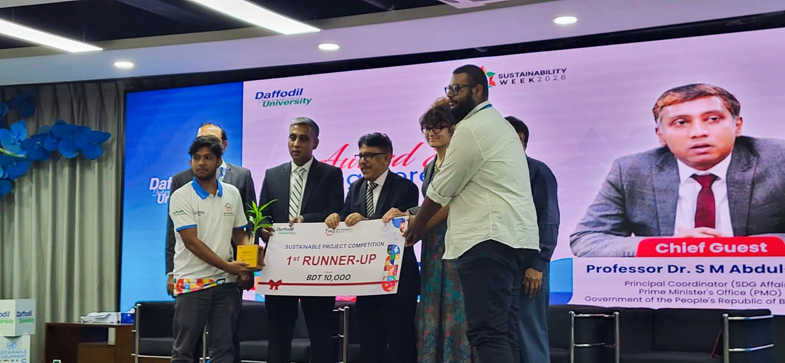
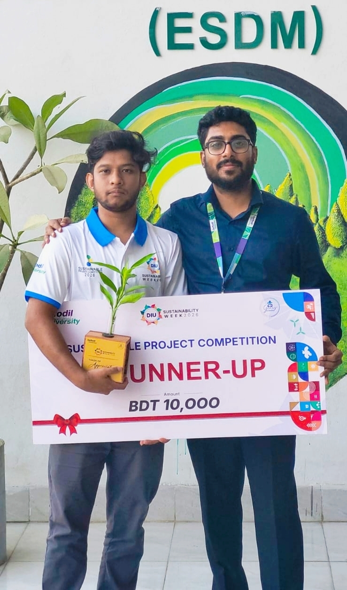
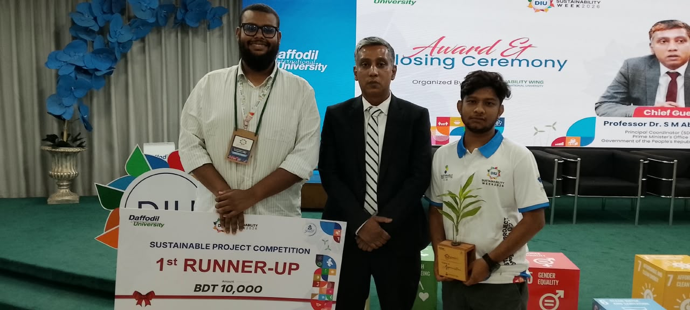

# SolariQ — Canal-Top Solar & GeoAI-Powered Precision Irrigation Framework

<div align="center">

[](https://daffodilvarsity.edu.bd)
[](https://daffodilvarsity.edu.bd)
[](https://www.timeshighereducation.com)
[](https://github.com)

**Sustainable Project Competition — DIU Sustainability Week 2026**  
*Organized by the Sustainability Wing, Daffodil International University (DIU)*

</div>

---

## 🏆 Honors & Recognition

> **Awarded 1st Runner-Up** at the prestigious **Sustainable Project Competition (DIU Sustainability Week 2026)**, recognized by university leadership, international delegates, and the **Prime Minister's Office (PMO)** of Bangladesh for engineering a functional, scalable climate adaptation prototype.

<table align="center" width="100%">
  <tr>
    <td colspan="2" align="center">
      
      <br />
      <sub><b>Figure 1:</b> Receiving the 1st Runner-Up Award from Chief Guest <b>Professor Dr. S. M. Abdul-Awal</b>, <em>Principal Coordinator (SDG Affairs), Prime Minister's Office (PMO), Government of Bangladesh</em>, alongside university dignitaries.</sub>
    </td>
  </tr>
  <tr>
    <td width="42%" align="center">
      
      <br />
      
    </td>
    <td width="58%" align="center">
      
      <br />
      <sub><b>Figure 3:</b> Team SolariQ on the main ceremony stage at the DIU Sustainability Week 2026 closing event with distinguished guests and the SDG pavilion.</sub>
    </td>
  </tr>
</table>

---

## 🌾 The Challenge

In rural river basin regions of Bangladesh (such as the Dharla and Teesta basins in Kurigram):
1. **Severe Water Losses:** Fragmented smallholder paddies suffer up to **47% irrigation water loss** due to continuous standing flooding and open-canal evaporation.
2. **High Emissions & Energy Burden:** Smallholder farmers rely heavily on fossil-fuel diesel shallow tubewells (STWs), causing high operational costs (BDT 105/L diesel) and greenhouse gas emissions.
3. **Sensor Failure in Smallholder Plots:** Traditional in-situ soil moisture probes suffer from rapid sensor corrosion, soil salt encrustation, and prohibitive capital cost across millions of 10-decimal cadastral plots.

---

## 💡 The SolariQ Solution

SolariQ replaces fragile soil probes with an integrated **Canal-Top Solar + GeoAI-Driven Precision Irrigation Framework**:

```
                       CANAL SOLAR PUMP STATION
                     (Lat_p, Lon_p) [10 kWp CTPV]
                                   │
              ┌────────────────────┴────────────────────┐
              ▼ (Geodesic / Canal Network Distance)      ▼
      Plot 1: Abdul Malek                     Plot 5: Nurul Islam
    (25.81572°N, 89.64202°E)               (25.81601°N, 89.64414°E)
   • 69.5m (Head Loss: 3.42m)             • 275.4m (Head Loss: 13.56m)
   • Low friction head loss               • High friction head loss
   • Aerobic drying phase (+0.63cm)       • 🚨 Breached AWD (-15.35cm)
                                          • Auto-trigger ESP8266 Pump
```

### 1. Canal-Top Photovoltaic (CTPV) Microgrid
* **Dual-Benefit Canopy:** Solar panels installed over water canals produce clean renewable energy while shading the canal surface, reducing open-channel evaporation by over **40%**.
* **Evaporative Cooling Gain:** The microclimate created by canal water provides natural panel cooling, boosting photovoltaic efficiency by **+3.8%**.
* **Clean Grid Export:** Excess solar power is routed into the local 33kV rural grid under national net-metering guidelines (0.62 tCO₂/MWh avoided grid emission factor).

### 2. GeoAI Agronomic & Hydraulic Engine
* **Coordinate-Driven Ingestion:** Ingests WGS84 GPS boundary coordinates from cadastral land parcel records (`kurigram_parcels.json`).
* **FAO-56 Penman-Monteith Evapotranspiration ($ET_0$):** Derives extraterrestrial solar radiation ($R_a$) and reference $ET_0$ from coordinate latitude ($25.815^\circ\text{N}$) without requiring per-plot pyranometers.
* **Hazen-Williams Hydraulic Topology:** Computes geodesic pipeline distance and dynamic friction head loss ($h_f$) between the Canal Pump Station and each farm plot.
* **AWD Deficit Tracking:** Tracks the daily soil water balance ($W_t = W_{t-1} + P_t - ET_c - DP_t$). When water levels breach the **$-15\text{ cm}$ Alternate Wetting and Drying (AWD)** threshold, an automated irrigation event is triggered to reflood to $+4\text{ cm}$, saving **35% water** and cutting rice methane emissions.

### 3. Edge-IoT Actuation & Hardware-in-the-Loop Prototype
* **Cloud-to-Edge REST Telemetry:** The GeoAI decision engine dynamically synthesizes actuation payloads for the edge hardware.
* **Dual-Microcontroller Edge Architecture:**
  * **NodeMCU ESP8266 (ESP-12E):** Connects via Wi-Fi/HTTP to the SCADA cloud, handles command queues (`/api/iot/device/commands`), heartbeats, and status telemetry (`/api/iot/device/status`).
  * **Arduino Nano (ATmega328P):** Receives the hardware trigger pulse on `D2` and drives an automated mechanical servo switch / motor pump on `D9` with built-in failsafes.

---

## 🛠️ System Architecture & Codebase

```
sustain-competition/
├── GeoAI/
│   ├── geoai_core.py          # Core GeoAI engine: coordinates, FAO-56, Hazen-Williams
│   ├── kurigram_parcels.json  # 6 cadastral parcels along Dharla River Canal
│   └── simulate_geoai.py      # Executable simulation runner & payload generator
├── prototype/
│   └── solariq_esp8266_firmware/
│       ├── main/
│       │   ├── work-project.ino         # NodeMCU ESP8266 live competition firmware
│       │   └── arduino-servo-code.ino   # Arduino Nano mechanical actuator firmware
│       └── proto/
│           └── proto.ino                # Secondary testbench firmware
├── solariq-app/                         # Next.js 16 SCADA web dashboard & digital twin
│   ├── app/
│   │   ├── work/page.tsx                # Live hardware control & telemetry console
│   │   ├── proto/page.tsx               # Animated SVG national grid & cadastral map
│   │   ├── report/page.tsx              # Data science & seasonal telemetry analytics
│   │   └── api/iot/                     # Real-time IoT command & status endpoints
│   └── lib/
│       ├── kurigramGeoAI.ts             # TypeScript agronomic calculations
│       └── iotDeviceState.ts            # In-memory IoT state manager
├── win-1.jpeg                           # Award ceremony: Faculty Mentorship
├── win-2.jpeg                           # Award ceremony: Handover with Chief Guest
└── win-3.jpeg                           # Award ceremony: Team on Stage
```

---

## ⚡ Quickstart

### 1. Run the GeoAI Coordinate Simulation
```bash
cd GeoAI
python simulate_geoai.py
```
*Evaluates coordinates of all 6 cadastral plots, computes solar declination, simulates multi-day evapotranspiration drying, detects Plot 5 AWD deficit, and synthesizes the exact REST payload for the edge hardware.*

### 2. Run the Next.js SCADA Web Interface
```bash
cd solariq-app
npm install
npm run dev
```
Open [http://localhost:3000](http://localhost:3000) in your browser:
* **`/work`**: Real-time IoT hardware telemetry and motor actuator console.
* **`/proto`**: Animated SVG digital twin showing Canal-Top Solar, 33kV Grid feed, and cadastral parcel irrigation.
* **`/report`**: Data science seasonal audit with live CSV telemetry exporter.

### 3. Flash Hardware Firmware
* Upload `prototype/solariq_esp8266_firmware/main/work-project.ino` to the **NodeMCU ESP8266**.
* Upload `prototype/solariq_esp8266_firmware/main/arduino-servo-code.ino` to the **Arduino Nano**.
* Connect **ESP8266 D1 $\to$ Nano D2** with a shared **Common GND**.

---

## 🌍 Sustainable Development Goals (SDGs) Addressed

| SDG | Goal | SolariQ Impact |
| :---: | :--- | :--- |
| **SDG 2** | Zero Hunger | Precision AWD irrigation preserves root aeration, optimizing Boro rice paddy yields. |
| **SDG 6** | Clean Water & Sanitation | Cuts agricultural irrigation water consumption by **35%**, preventing groundwater depletion. |
| **SDG 7** | Affordable & Clean Energy | Replaces fossil diesel pumps with a 10 kWp Canal-Top Solar microgrid exporting surplus power. |
| **SDG 13** | Climate Action | Suppresses anaerobic methane ($CH_4$) emissions through AWD cyclic drying and reduces diesel carbon emissions. |

---

## 👥 Team & Acknowledgements

* **Lead Innovator:** Md Abu Sayem Sarker
* **Department:** Department of Environmental Science and Disaster Management (ESDM)
* **Institution:** Daffodil International University (DIU), Bangladesh *(Ranked 87th Globally in THE Sustainability Impact Rankings 2026, #1 in Bangladesh)*
* **Event:** DIU Sustainability Week 2026 — Organized by **Sustainability Wing, DIU**
* **Chief Guest:** Professor Dr. S. M. Abdul-Awal, Principal Coordinator (SDG Affairs), Prime Minister's Office (PMO)

---

<div align="center">
  <sub>Engineered with precision for sustainable agriculture and climate resilience in the Global South.</sub>
</div>
